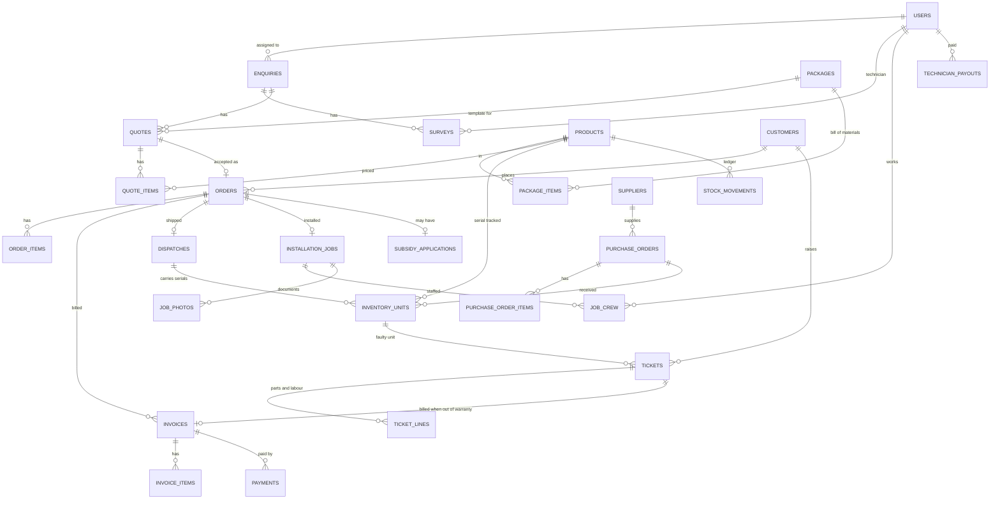

# SunPower Solar ERP

Solar Installation Management System: takes a rooftop-solar customer from the first enquiry to the 20-year warranty
(enquiry, site survey, quote, order and payment, dispatch with serial numbers, installation sign-off, service tickets, profit reports).

## Stack (PERN + TypeScript)

- **Frontend:** React 18 + TypeScript (Vite), React Router, hand-written CSS design system (SaaS theme)
- **Backend:** Node.js + Express (TypeScript), layered `routes -> controllers -> services -> repositories`, Zod validation,
  JWT + bcrypt auth, Helmet / CORS / rate limiting, centralized error handling, Socket.IO for real-time notifications
- **Database:** PostgreSQL (local) with Prisma for schema, migrations and types
- **Tooling:** ESLint + Prettier, tsx, Swagger (OpenAPI) docs, dotenv

No Firebase / Supabase / MongoDB Atlas and no static JSON in the final solution.

See [docs/PROJECT_STRUCTURE.md](docs/PROJECT_STRUCTURE.md) for the folder layout.

## Run it locally

Three terminals, from the repository root.

```powershell
# 1. Database (embedded PostgreSQL on :5433), or point DATABASE_URL at your own Postgres
cd backend; npm install; npm run db:embedded

# 2. API on :4000 (docs at /api/docs). First time only: npm run db:setup  (migrate + demo seed)
cd backend; npm run dev

# 3. Web app on :5173
cd frontend; npm install; npm run dev
```

Demo logins (password `Sunpower@123`): `admin@`, `sales@`, `tech1@`, `warehouse@`, `support@`, `director@` followed by `sunpower.test`.

`npm run e2e` in `backend` walks the whole business flow against a running API (73 checks).

## Business flow

```
Enquiry -> phone qualification -> site survey (approved) -> quote -> order + invoice
  -> advance payment confirms order -> dispatch (scan serial numbers) -> delivery (warranty starts)
  -> installation sign-off (photos + customer signature) -> service tickets (free in warranty, billed after)
```

Database triggers enforce the rules that must never be broken (no quote without an approved survey, no negative stock,
warranty clock starts on delivery); views power the profitability and unfinished-order reports.

## Database design



The full schema lives in [backend/prisma/schema.prisma](backend/prisma/schema.prisma) and the SQL migrations
(including triggers and views) in `backend/prisma/migrations`.
